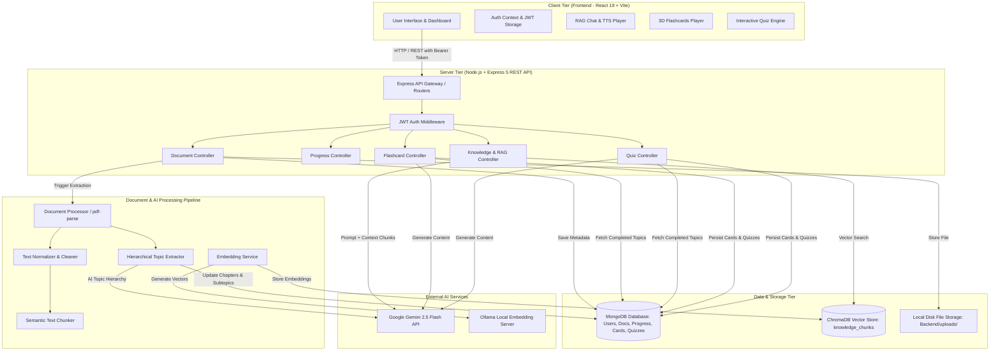

# AI-KMS (AI Knowledge Management System)

[](https://opensource.org/licenses/ISC)
[](https://react.dev/)
[](https://nodejs.org/)
[](https://www.mongodb.com/)
[](https://ai.google.dev/)
[](https://www.trychroma.com/)

> **A personalized, AI-powered knowledge workspace that transforms static learning materials into an interactive, curriculum-grounded learning ecosystem with Semantic Search (RAG), dynamic topic extraction, 3D spaced revision flashcards, and automated assessments.**

---

## Table of Contents

- [1. Project Title and Overview](#1-project-title-and-overview)
- [2. Project Description](#2-project-description)
- [3. Problem Statement](#3-problem-statement)
- [4. Project Objectives](#4-project-objectives)
- [5. Key Features](#5-key-features)
  - [5.1 Implemented Features](#51-implemented-features)
  - [5.2 Planned Features](#52-planned-features)
- [6. Technology Stack](#6-technology-stack)
- [7. System Architecture Overview](#7-system-architecture-overview)
- [8. Project Folder Structure](#8-project-folder-structure)
- [9. Prerequisites](#9-prerequisites)
- [10. Installation and Setup](#10-installation-and-setup)
- [11. Environment Variables Configuration](#11-environment-variables-configuration)
- [12. How to Run the Project](#12-how-to-run-the-project)
- [13. How to Use the Application](#13-how-to-use-the-application)
- [14. AI and RAG Workflow](#14-ai-and-rag-workflow)
- [15. Database and Document Processing Overview](#15-database-and-document-processing-overview)
- [16. User Interface & Screen Previews](#16-user-interface--screen-previews)
- [17. API Overview](#17-api-overview)
- [18. Testing Instructions](#18-testing-instructions)
- [19. Current Implementation Status](#19-current-implementation-status)
- [20. Future Enhancements](#20-future-enhancements)
- [21. Team Members and Contributions](#21-team-members-and-contributions)
- [22. Documentation Links](#22-documentation-links)
- [23. Troubleshooting](#23-troubleshooting)
- [24. License](#24-license)

---

## 1. Project Title and Overview

**AI-KMS (AI Knowledge Management System)** is a comprehensive full-stack platform developed as a Computer Science & Engineering major project. It serves as an intelligent personal learning assistant and academic repository designed to bridge the gap between static reference documents (lecture slides, textbook chapters, syllabus guides, research papers, and lecture notes) and active, measurable learning.

Rather than treating learning materials as passive files stored across disjointed folders, AI-KMS automatically ingests documents, normalizes their text, discovers authentic hierarchical syllabus structures, indexes them into a high-dimensional vector space, and provides students with grounded conversational Q&A, interactive 3D flashcards, and automated assessment quizzes.

---

## 2. Project Description

Modern higher education requires students to navigate massive volumes of academic literature, digital slide decks, syllabus outlines, and personal notes. Traditional cloud drives and PDF readers operate as static document warehouses; they do not extract contextual hierarchies, cannot evaluate a student's topic mastery, and cannot generate personalized revision materials on demand.

AI-KMS is built around an active learning paradigm:
1. **Dynamic Content Grounding**: Any multi-format document (`.pdf`, `.docx`, `.pptx`, `.txt`, `.md`) uploaded by a student is parsed and passed to an AI-driven Curriculum Extractor that organizes content into parent chapters and granular subtopics.
2. **Context-Grounded Conversational Assistance**: Integrated Retrieval-Augmented Generation (RAG) ensures student questions are answered with high factual accuracy, strictly grounded in the student's own uploaded materials using cosine-similarity vector retrieval and Google Gemini LLMs.
3. **Adaptive Revision & Retention**: Completed topics within the curriculum automatically feed into interactive 3D Flashcards and 4-Option Multiple Choice Assessment Quizzes with real-time feedback, detailed conceptual explanations, and attempt analytics.

---

## 3. Problem Statement

Learners, university students, and independent researchers face severe friction in their study routines:

- **Fragmented Materials**: Course notes, lab manuals, presentations, and reference books remain scattered across local drives and cloud folders, leading to tedious retrieval times.
- **Passive Reading Inefficiency**: Standard document viewers restrict learners to passive reading with no interactive, grounded query mechanism to resolve conceptual doubts instantly.
- **Unstructured Syllabi & Knowledge Silos**: Complex course concepts remain isolated without clear conceptual connections, hierarchical breakdown, or visible progress tracking.
- **Difficulty Measuring Topic Mastery**: Students lack objective feedback regarding which syllabus modules they have mastered and where their retention is weak before examinations.
- **Time-Consuming Study Preparation**: Manually creating revision flashcards and practice test questions from hundreds of lecture pages consumes valuable study hours.

---

## 4. Project Objectives

1. **Automate Document Parsing & Structure Discovery**: Ingest multi-format learning materials and use AI to automatically extract clean, hierarchical chapters and subtopics without manual syllabus entry.
2. **Implement Grounded RAG Search**: Eliminate LLM hallucinations by retrieving vector-embedded passages from user documents and augmenting prompts for factual, citation-backed answers.
3. **Deliver an Interactive Learning Dashboard**: Provide students with visual progress indicators, topic checklists, subject distribution metrics, and recent activity streams.
4. **Facilitate Active Recall with 3D Flashcards**: Implement a 3D flip-card study player with keyboard navigation (`Space`, arrows, `1`/`2` mastery tagging) and instant question-jump selectors.
5. **Provide Continuous Assessment**: Automatically generate 4-option MCQs directly from completed topics and reference notes, complete with live timers, immediate answer validation, and attempt history tracking.
6. **Ensure Strict Data Isolation & Security**: Protect user accounts with salted Bcrypt hashing, signed JSON Web Tokens (JWT), and user-scoped database and vector collection queries.

---

## 5. Key Features

### 5.1 Implemented Features

- **Authentication & Account Security**:
  - Secure user registration with input validation (alphabet-only name constraints, strong password regex).
  - Password encryption using `bcryptjs` (10 salt rounds).
  - Persistent login sessions with JSON Web Tokens (JWT) stored in `localStorage`.
  - Protected API routes and React Router higher-order component guards.
  - User profile management with avatar presets and current-password-verified password updates.

- **Document Ingestion & Repository**:
  - Multipart document upload via Multer with a 20MB file size cap.
  - Supported file formats: `.pdf`, `.ppt`, `.pptx`, `.doc`, `.docx`, `.txt`, `.md`.
  - In-browser interactive Document Viewer Modal featuring metadata inspection, embedded PDF iframe preview, download, and external tab view.
  - Document management with search, subject filtering, and disk/database synchronized deletion.

- **Curriculum Progress Tracking & Hierarchical Topics**:
  - Pure document-driven subjects generated dynamically from uploaded coursework.
  - Hierarchical chapter and subtopic accordion checklist with optimistic UI updates.
  - In-place subject renaming with automatic cascade updates across all linked documents and progress cards.
  - Safe, GitHub-style confirmation dialog for subject deletion.
  - Real-time overall progress percentage and subject distribution progress bars.

- **Context-Grounded AI Chat (RAG)**:
  - Document text extraction using `pdf-parse` with automated noise and artifact filtering.
  - Document text chunking with semantic sliding windows and overlap boundaries.
  - Vector embeddings generation with ChromaDB integration and local Ollama (`nomic-embed-text`) support with zero-vector fallback.
  - Conversational Q&A powered by Google Gemini 2.5 Flash, strictly grounded in retrieved document chunks.
  - Search context selector enabling students to query across all uploaded documents or scope questions to a specific document.
  - On-demand Text-to-Speech (TTS) voice playback for AI responses.

- **Smart 3D Flashcards & Spaced Revision**:
  - AI-powered flashcard generation grounded in user-completed topics and uploaded document text.
  - Manual flashcard creator for customized revision prompts, answers, hints, and difficulty ratings.
  - Interactive 3D flip card study deck with CSS perspective transforms.
  - Numbered direct question jump tabs (`[1]`, `[2]`, `[3]`, etc.) with mastery badges.
  - Full keyboard shortcuts (`Space` to flip, `ArrowLeft`/`ArrowRight` to navigate, `1` for practice, `2` for mastered).
  - "All Cards" gallery view with live search, topic badges, and one-click transition to study mode.

- **AI Assessment & Quiz Engine**:
  - Automated generation of 4-option MCQs with difficulty ratings (`easy`, `medium`, `hard`, `mixed`).
  - Interactive quiz player featuring a live countdown timer, question counter, and progress bar.
  - Instant visual feedback on answer selection (green for correct, red for incorrect) with detailed conceptual explanations.
  - Quiz attempt history tracking, accuracy score calculations, and best percentage persistence.
  - Quiz Hub with overview metrics, subject filtering, retake capability, and direct deletion.

### 5.2 Planned Features

- **Concept Extraction & Knowledge Graphs (Phase 3)**:
  - Automated extraction of concept triplets `(Entity, Relation, Entity)` from document text chunks.
  - Interactive Knowledge Graph visualization canvas (e.g., Cytoscape.js / D3.js) to explore conceptual connections across subjects.
- **Knowledge Gap Detection & Recommendations (Phase 4)**:
  - Predictive analytics identifying uncompleted prerequisite topics and recurring quiz mistakes.
  - Automated recommendations directing students to specific document pages and remedial flashcard decks.

---

## 6. Technology Stack

### Frontend Architecture
| Technology | Version | Purpose |
|---|---|---|
| **React** | `19.2.8` | Component-based UI library |
| **Vite** | `8.2.2` | Next-generation frontend build tool and dev server |
| **React Router DOM** | `7.18.3` | Client-side routing and protected navigation |
| **Axios** | `1.20.0` | Promise-based HTTP client with request interceptors |
| **Lucide React** | `1.42.0` | Comprehensive iconography system |
| **React Markdown** | `10.1.0` | Renders formatted markdown in AI chat bubbles |
| **Vanilla CSS** | Standard | Custom modular design system with glassmorphic dark theme |

### Backend Architecture
| Technology | Version | Purpose |
|---|---|---|
| **Node.js** | `>=18.0.0` | Server-side JavaScript runtime environment (ES Modules) |
| **Express.js** | `5.2.1` | RESTful API routing, middleware, and HTTP server |
| **Mongoose** | `9.9.4` | MongoDB Object Data Modeling (ODM) library |
| **Multer** | `2.3.0` | Multipart/form-data middleware for file uploads |
| **jsonwebtoken** | `9.0.3` | Secure stateless user session authorization |
| **bcryptjs** | `3.0.3` | Password hashing with cryptographic salts |
| **pdf-parse** | `2.4.5` | PDF text extraction and parsing engine |
| **dotenv** | `17.4.2` | Environment variables configuration loader |
| **cors** | `2.8.6` | Cross-Origin Resource Sharing middleware |
| **nodemon** | `3.1.14` | Development auto-reload file watcher |

### Artificial Intelligence, Vector Store & Database
| Component | Technology | Description |
|---|---|---|
| **Large Language Model** | Google Gemini 2.5 Flash | Grounded Q&A, topic extraction, flashcards, and quiz generation |
| **Vector Database** | ChromaDB (`chromadb` `3.5.0`) | High-dimensional vector store with cosine distance metric |
| **Embedding Model** | Ollama (`nomic-embed-text`) | 768-dimensional local dense embeddings with offline fallback |
| **Primary Database** | MongoDB | Stores users, document metadata, curriculum progress, flashcards, and quizzes |

---

## 7. System Architecture Overview

The system employs a decoupled, client-server REST architecture with modular services for document processing, vector storage, and AI reasoning.



---

## 8. Project Folder Structure

```
ai-kms/
├── .agents/                        # Local agent configurations & rules
├── .gitignore                      # Git ignore specifications
├── README.md                       # Comprehensive project documentation
├── docs/                           # Architectural, UI/UX, and technical design specs
│   ├── 01_PRD.md                   # Product Requirement Document
│   ├── 02_TRD.md                   # Technical Requirement Document
│   ├── 03_APP_FLOW.md              # Application User Flow Specifications
│   ├── 04_UI_UX.md                 # UI/UX Specifications & Color Tokens
│   ├── 05_BACKEND_SCHEMA.md        # Database Schemas & Data Structures
│   ├── 06_IMPLEMENTATION_PLAN.md   # Phased Module Delivery Plan
│   └── 07_PROJECT_STATE.md         # Active Development State Snapshot
├── Backend/                        # Node.js + Express REST API Server
│   ├── .env                        # Local environment variables (ignored by Git)
│   ├── .env.example                # Sample environment configuration template
│   ├── package.json                # Backend dependencies & run scripts
│   ├── testServices.js             # Pipeline diagnostic harness
│   ├── scripts/                    # Maintenance & test scripts
│   │   ├── inspect_hierarchy.js    # Topic hierarchy inspection utility
│   │   ├── sync_progress.js        # Progress model resync utility
│   │   └── test_hierarchy.js       # Curriculum extraction verification
│   ├── uploads/                    # Local storage directory for uploaded files
│   └── src/
│       ├── index.js                # Express server entry point & middleware wiring
│       ├── config/
│       │   └── db.js               # MongoDB Mongoose connection handler
│       ├── controllers/
│       │   ├── document.controller.js  # File upload, retrieval, and disk deletion
│       │   ├── flashcard.controller.js # AI & manual flashcard CRUD operations
│       │   ├── knowledge.controller.js # RAG processing, vector search, & grounded Q&A
│       │   ├── progress.controller.js  # Learning progress, topics toggle, & subjects
│       │   ├── quiz.controller.js      # AI quiz generation, scoring, & attempts
│       │   └── user.Controller.js      # Auth, profile updates, & password changes
│       ├── middleware/
│       │   ├── authMiddleware.js       # JWT authorization & user validation guard
│       │   ├── errorMiddleware.js      # 404 handler and central error middleware
│       │   └── uploadMiddleware.js     # Multer file storage & type filtering
│       ├── models/
│       │   ├── document.model.js       # Mongoose Document schema
│       │   ├── flashcard.model.js      # Mongoose Flashcard schema
│       │   ├── progress.model.js       # Mongoose Progress, Topics, & Activities schema
│       │   ├── quiz.model.js           # Mongoose Quiz & Attempts schema
│       │   └── user.model.js           # Mongoose User schema with bcrypt pre-save hook
│       ├── routes/
│       │   ├── document.routes.js      # /api/documents routing definitions
│       │   ├── flashcard.routes.js     # /api/flashcards routing definitions
│       │   ├── knowledge.routes.js     # /api/knowledge routing definitions
│       │   ├── progress.routes.js      # /api/progress routing definitions
│       │   ├── quiz.routes.js          # /api/quizzes routing definitions
│       │   └── user.routes.js          # /api/auth & /api/users routing definitions
│       ├── services/
│       │   ├── chromaService.js        # ChromaDB vector collection operations
│       │   ├── documentProcessor.js    # Multi-format document text extraction
│       │   ├── embeddingService.js     # Text chunk vector embedding generation
│       │   ├── textChunker.js          # Semantic window chunking logic
│       │   ├── textCleaner.js          # Text normalization & artifact cleaning
│       │   └── topicExtractor.service.js # Universal AI curriculum extractor
│       └── utils/
│           └── generateToken.js        # Signed JWT token generation utility
└── Frontend/                       # React 19 + Vite Client Application
    ├── package.json                # Frontend dependencies & scripts
    ├── vite.config.js              # Vite configuration
    ├── index.html                  # Single Page Application HTML root
    ├── public/
    │   ├── favicon.svg             # Application brand favicon
    │   └── icons.svg               # SVG icons sheet
    ├── tests/
    │   └── voice.test.js           # Voice synthesis utility test
    └── src/
        ├── main.jsx                # React DOM mounting entry point
        ├── App.jsx                 # Route definitions & protected route wrappers
        ├── api/                    # Axios API client modules
        │   ├── authApi.js          # Auth endpoints & request interceptor
        │   ├── documentApi.js      # Document upload and management endpoints
        │   ├── flashcardApi.js     # Flashcard deck and study endpoints
        │   ├── knowledgeApi.js     # RAG search and chat endpoints
        │   ├── progressApi.js      # Progress dashboard and topic toggle endpoints
        │   └── quizApi.js          # Quiz generation and evaluation endpoints
        ├── context/
        │   └── AuthContext.jsx     # Global user authentication provider
        ├── pages/
        │   ├── Dashboard.jsx       # Central workspace container
        │   ├── Login.jsx           # User login page
        │   ├── Register.jsx        # User registration page
        │   ├── Profile.jsx         # Profile and security settings page
        │   ├── Signup.jsx          # Alternate signup route
        │   ├── ForgotPassword.jsx  # Password recovery placeholder
        │   └── ResetPassword.jsx   # Password reset placeholder
        ├── components/
        │   ├── auth/               # Auth form wrappers and ProtectedRoute
        │   ├── common/             # Reusable Navbar, Logo, and shared components
        │   └── dashboard/          # Specialized workspace components
        │       ├── ChatInput.jsx             # Conversational prompt input
        │       ├── ChatWindow.jsx            # Message stream & markdown display
        │       ├── CreateSubjectModal.jsx    # Custom subject creation dialog
        │       ├── DashboardOverview.jsx     # Main KPI stats & subject cards grid
        │       ├── DeleteConfirmModal.jsx    # Destruction confirmation dialog
        │       ├── DocumentViewerModal.jsx   # In-browser document preview modal
        │       ├── FlashcardsView.jsx        # 3D interactive flashcard player
        │       ├── LearningProgressSection.jsx # Progress visualization bar
        │       ├── OverviewStats.jsx         # Overview statistics counter chips
        │       ├── QuickActionsBar.jsx       # Action shortcuts toolbar
        │       ├── QuizView.jsx              # Assessment player and Quiz Hub
        │       ├── RecentActivitySection.jsx # Chronological activity timeline
        │       ├── Sidebar.jsx               # Navigation drawer and documents list
        │       ├── SubjectCard.jsx           # Subject card with progress percentage
        │       ├── SubjectDetailModal.jsx    # Hierarchical topic accordion checklist
        │       └── UploadModal.jsx           # Drag-and-drop document upload modal
        └── styles/                 # Modular CSS stylesheets
            ├── auth.css            # Authentication views styling
            ├── dashboard.css       # Main workspace layout styling
            ├── flashcards.css      # 3D perspective and card study styling
            ├── quiz.css            # Quiz hub, timer, and option cards styling
            └── index.css           # Global CSS variables, resets, and tokens
```

---

## 9. Prerequisites

Before installing and running the project, verify that your development environment meets the following requirements:

- **Node.js**: Version `18.x` or `20.x` LTS installed.
- **npm**: Version `9.x` or `10.x` (bundled with Node.js).
- **MongoDB**: MongoDB Community Server `6.x` or `7.x` running locally on port `27017`, or a MongoDB Atlas cloud connection URI.
- **Google Gemini API Key**: A free or paid API key obtained from [Google AI Studio](https://aistudio.google.com/).
- **Git**: Installed for version control operations.
- *(Optional for Local Vectors)*:
  - **ChromaDB**: Chroma vector server running on port `8000` (`chroma run --path ./chroma_db`).
  - **Ollama**: Local Ollama server running on port `11434` with the `nomic-embed-text` model pulled (`ollama run nomic-embed-text`).

---

## 10. Installation and Setup

### 1. Clone the Repository
```bash
git clone https://github.com/mohdaffan01/ai-kms.git
cd ai-kms
```

### 2. Configure and Install Backend
Open a terminal in the project root:
```bash
cd Backend
npm install
```

### 3. Configure and Install Frontend
Open a separate terminal in the project root:
```bash
cd Frontend
npm install
```

---

## 11. Environment Variables Configuration

The backend requires an environment file (`.env`) placed in the `Backend/` directory. Create this file by copying the template:

```bash
cd Backend
cp .env.example .env
```

Edit `Backend/.env` with your preferred text editor and configure the keys:

```ini
# Server Port Configuration
PORT=3000

# MongoDB Database Connection String
MONGO_URI=mongodb://127.0.0.1:27017/aikms

# Secret key used for signing JSON Web Tokens (use a strong random string)
JWT_SECRET=your_jwt_secret_key_here

# Frontend Application Origin (for CORS validation)
CLIENT_URL=http://localhost:5173

# Google Gemini API Key (Required for AI extraction, RAG, flashcards, and quizzes)
GEMINI_API_KEY=AIzaSyYourGeminiApiKeyHere

# (Optional) Preferred Gemini Model Identifier
GEMINI_MODEL=gemini-2.5-flash

# (Optional) Local ChromaDB Vector Database URL
CHROMA_URL=http://localhost:8000
CHROMA_COLLECTION=knowledge_chunks

# (Optional) Local Ollama Embeddings Service
OLLAMA_HOST=http://localhost:11434
EMBEDDING_MODEL=nomic-embed-text
```

> **Security Note:** Never commit `Backend/.env` to source control. It is already included in `.gitignore`.

---

## 12. How to Run the Project

Running the project requires both the Backend server and the Frontend client development servers to be active concurrently.

### Terminal 1: Launch Backend Server
```bash
cd Backend
npm run dev
```
*The backend server will initialize on `http://localhost:3000` and automatically establish a connection with MongoDB.*

### Terminal 2: Launch Frontend Client
```bash
cd Frontend
npm run dev
```
*Vite will compile the assets and provide the local development URL (typically `http://localhost:5173`).*

Access the application in your browser at: **`http://localhost:5173`**

---

## 13. How to Use the Application

### 1. Account Setup
- Navigate to `http://localhost:5173/register` or `http://localhost:5173/login`.
- Register an account with your full name, email, and a secure password (minimum 8 characters with upper, lower, and numeric characters).
- Upon login, your JWT token is securely stored and you are redirected to the main workspace.

### 2. Learning Progress Dashboard & Subject Structure
- The dashboard opens by default to the **Overview Tab**.
- View your KPI statistics (Total Subjects, Topics Studied, Overall Progress %, and Documents Uploaded).
- The subject grid dynamically displays subjects extracted from your uploaded study materials.

### 3. Uploading Study Materials
- Click **"Upload Content"** in the left sidebar or the top dashboard action bar.
- Drag and drop or browse for an academic document (`.pdf`, `.docx`, `.pptx`, `.txt`, `.md`).
- Enter the academic subject name (e.g., `Database Management Systems` or `DBMS`).
- Click **"Upload Document"**.
- The backend stores the file in `Backend/uploads/` and triggers the AI Topic Extractor, which parses chapters and subtopics directly into your curriculum checklist.

### 4. Exploring Syllabi & Managing Progress
- Click on any subject card to open the **Hierarchical Subject Detail Modal**.
- View chapters and subtopics arranged in an accordion tree.
- Check off subtopics as you finish studying them; progress percentages calculate in real time.
- Use the inline **Pencil** icon to rename a subject, or delete a subject using the confirmation dialog.

### 5. Document-Grounded RAG Chat
- Click the **"Chat / Q&A"** tab in the sidebar.
- Use the **Search Context** dropdown to select whether to search across all documents or focus queries on a specific document.
- Ask questions regarding concepts, definitions, algorithms, or code contained in your files.
- The AI responds strictly with facts grounded in your notes, providing clear formatting and an on-demand voice synthesis audio player.

### 6. Studying with 3D Flashcards
- Switch to the **"Flashcards"** view.
- Click **"Generate with AI"** to generate revision cards directly from your completed topics and document text, or click **"Add Card"** to create a custom card.
- In **Study Mode**, flip cards using the 3D animation (click card or press `Space`), navigate using arrow keys (`←`, `→`), or mark cards as mastered (`1` for practice, `2` for mastered).
- Use the numbered question tabs (`[1]`, `[2]`, `[3]`, etc.) to jump directly to any question.
- Switch to **"All Cards"** grid view to search and inspect all cards at a glance.

### 7. Self-Assessment with AI Quizzes
- Switch to the **"AI Quiz"** view.
- Click **"Generate AI Quiz"**, select your target subject, topic scope, and question count (3 to 10 MCQs).
- Enter the **Quiz Player** with a live timer and interactive 4-option cards.
- Receive instant feedback upon selecting an option (green highlight for correct answers, red for incorrect), accompanied by an in-depth conceptual explanation.
- View your final score percentage, review metrics, and inspect historical attempts in the Quiz Hub.

---

## 14. AI and RAG Workflow

The Retrieval-Augmented Generation (RAG) and curriculum extraction pipelines follow a deterministic, multi-stage process:

```
[ Uploaded Document (.pdf, .docx, .pptx, etc.) ]
                      │
                      ▼
        [ Document Processor: pdf-parse ]
                      │  (Extract raw text content)
                      ▼
         [ Text Normalizer: textCleaner ]
                      │  (Strip noise, headers, media artifacts, whitespace)
                      ▼
         [ Semantic Chunker: textChunker ]
                      │  (Chunks: 400-800 chars, 50-100 char overlap window)
                      ▼
        [ Embedding Engine: embeddingService ]
                      │  (Dense vector generation via Ollama / nomic-embed-text)
                      ▼
        [ Vector Database: chromaService ]
                      │  (Upsert vectors into 'knowledge_chunks' with userId metadata)
                      ▼
[ User Question ] ──► [ Query Vector Embedding ] ──► [ Cosine Similarity Search ]
                                                              │
                                                              ▼
                                                   [ Top-K Relevant Chunks ]
                                                              │
                                                              ▼
[ Augmented Prompt: Context Chunks + Query ] ────────► [ Google Gemini 2.5 Flash ]
                                                              │
                                                              ▼
                                              [ Grounded, Hallucination-Free Answer ]
```

### Universal Hierarchical Topic Extractor
When a document is uploaded, `topicExtractor.service.js` sends clean text samples to Google Gemini with strict structural JSON prompts:
- Automatically distinguishes units, chapters, and nested subtopics.
- Applies universal linguistic sanitization to filter out multiple-choice questions, exam papers, review exercises, and fragmented sentences.
- Features a resilient heuristic regex fallback engine ensuring topic discovery proceeds even during API timeouts.

---

## 15. Database and Document Processing Overview

AI-KMS uses MongoDB with Mongoose strict schemas for structured relational data and ChromaDB for vector persistence.

### MongoDB Collections Summary

| Collection | Schema File | Key Attributes | Purpose |
|---|---|---|---|
| **`users`** | `user.model.js` | `name`, `email`, `password` (hashed), `profileImage`, `role` | User accounts, credentials, and authentication |
| **`documents`** | `document.model.js` | `title`, `filePath`, `mimeType`, `fileSize`, `subject`, `uploadedBy`, `processingStatus` | File upload tracking and metadata repository |
| **`progress`** | `progress.model.js` | `userId`, `subjects` (nested chapters & subtopics array), `recentActivities` | Academic curriculum checklist, progress %, and activity logs |
| **`flashcards`** | `flashcard.model.js` | `userId`, `subject`, `topic`, `front`, `back`, `hint`, `difficulty`, `isMastered`, `reviewCount` | Spaced retention cards with mastery flags |
| **`quizzes`** | `quiz.model.js` | `userId`, `subject`, `questions` (options, correctAnswer, explanation), `attempts`, `bestScore`, `bestPercentage` | Multiple-choice assessments and performance tracking |

### ChromaDB Vector Collection (`knowledge_chunks`)
- **Metric**: Cosine Distance (`hnsw:space: cosine`).
- **Metadata Payload**: `{ userId, documentId, chunkIndex, charCount }`.
- **Query Isolation**: Queries enforce a hard metadata filter `{ userId: { "$eq": userId } }` preventing cross-user data leakage.

---

## 16. User Interface & Screen Previews

The application features a modern, responsive interface built with glassmorphic styling, tailored HSL dark-mode palettes, and CSS 3D perspective animations.

| View / Module | Description | Key Capabilities |
|---|---|---|
| **Dashboard Overview** | Central student command center | Real-time KPI statistics cards, subject progress cards grid, visual progress distribution bar, and recent activity feed. |
| **Subject Detail Modal** | Hierarchical curriculum checklist | Accordion chapters, child subtopics, in-place title editing, GitHub-style deletion modal, and direct "Study Flashcards" / "Take Quiz" CTAs. |
| **RAG AI Chat Workspace** | Document-grounded conversational assistant | Context scope selector (All vs Specific Document), markdown rendering, auto-scrolling feed, and on-demand voice synthesis. |
| **3D Flashcards Deck** | Active recall study player | 3D card flip animations, numbered question jump pills, keyboard shortcuts (`Space`, arrows, `1`/`2`), and "All Cards" gallery mode. |
| **AI Assessment Quiz** | Multiple-choice evaluation module | Live timer, question progress bar, immediate green/red answer highlighting, detailed conceptual explanations, and attempt analytics. |
| **Document Viewer** | In-browser file inspector | Metadata breakdown, in-browser PDF iframe preview, download file capability, and document deletion. |

---

## 17. API Overview

All private endpoints require the `Authorization: Bearer <token>` header issued upon authentication.

### Authentication & Users
| Method | Endpoint | Access | Description |
|---|---|---|---|
| `POST` | `/api/auth/register` | Public | Register new user account with validated credentials |
| `POST` | `/api/auth/login` | Public | Authenticate user and issue signed JWT token |
| `GET` | `/api/auth/me` | Private | Retrieve authenticated user's profile |
| `PUT` | `/api/users/profile` | Private | Update user display name and profile image URL |
| `PUT` | `/api/users/change-password` | Private | Change password with current password verification |

### Document Management
| Method | Endpoint | Access | Description |
|---|---|---|---|
| `POST` | `/api/documents/upload` | Private | Upload file via Multer, create record, and extract topics |
| `GET` | `/api/documents/my-documents` | Private | Retrieve user's documents with optional filters (`subject`, `topic`, `folder`) |
| `DELETE` | `/api/documents/:id` | Private | Delete document record and remove file from disk storage |

### Knowledge & Vector Search (RAG)
| Method | Endpoint | Access | Description |
|---|---|---|---|
| `POST` | `/api/knowledge/process/:documentId` | Private | Extract, clean, chunk, embed, and index document into ChromaDB |
| `POST` | `/api/knowledge/search` | Private | Execute semantic vector search across indexed chunks |
| `POST` | `/api/knowledge/chat` | Private | Grounded conversational Q&A using Gemini 2.5 Flash |
| `DELETE` | `/api/knowledge/:documentId` | Private | Delete document vectors and embeddings from ChromaDB |

### Curriculum & Progress Tracking
| Method | Endpoint | Access | Description |
|---|---|---|---|
| `GET` | `/api/progress/dashboard` | Private | Fetch consolidated dashboard stats, subject cards, and activities |
| `POST` | `/api/progress/topic/toggle` | Private | Toggle chapter or subtopic completion checkbox |
| `POST` | `/api/progress/topic/add` | Private | Add custom chapter or subtopic to subject curriculum |
| `POST` | `/api/progress/subject` | Private | Create custom subject with color palette |
| `PUT` | `/api/progress/subject/:subjectId` | Private | Rename or update subject with automatic document resynchronization |
| `DELETE` | `/api/progress/subject/:subjectId` | Private | Delete subject curriculum and unlink associated documents |
| `POST` | `/api/progress/reset-defaults` | Private | Reset curriculum to active study materials |

### Smart Flashcards
| Method | Endpoint | Access | Description |
|---|---|---|---|
| `GET` | `/api/flashcards` | Private | Fetch flashcards with subject/topic/mastery filters and deck stats |
| `POST` | `/api/flashcards/generate` | Private | Generate AI flashcards based on completed topics and document notes |
| `POST` | `/api/flashcards` | Private | Create custom flashcard manually |
| `PATCH` | `/api/flashcards/:id/master` | Private | Toggle card mastery status and increment review count |
| `DELETE` | `/api/flashcards/:id` | Private | Delete a single flashcard |
| `POST` | `/api/flashcards/reset-mastery` | Private | Reset mastery status for all cards in a subject deck |

### AI Assessment Quizzes
| Method | Endpoint | Access | Description |
|---|---|---|---|
| `GET` | `/api/quizzes` | Private | Fetch user's quizzes and performance metrics |
| `POST` | `/api/quizzes/generate` | Private | Generate AI quiz based on completed topics and reference notes |
| `GET` | `/api/quizzes/:id` | Private | Retrieve single quiz details, questions, and attempt history |
| `POST` | `/api/quizzes/:id/submit` | Private | Submit quiz answers, calculate score, and record attempt |
| `DELETE` | `/api/quizzes/:id` | Private | Delete quiz record directly |

---

## 18. Testing Instructions

### 1. Backend Service Pipeline Test Harness
The backend includes an automated diagnostic harness verifying the text cleaner, chunking logic, Ollama connectivity, and ChromaDB health:

```bash
cd Backend
node testServices.js
```

### 2. Topic Extraction & Hierarchy Verification
Test curriculum structure extraction on sample documents:
```bash
cd Backend
node scripts/test_hierarchy.js
node scripts/inspect_hierarchy.js
```

### 3. Frontend Build Validation
Verify that the React frontend compiles without JSX, module, or linting errors:
```bash
cd Frontend
npm run build
```

---

## 19. Current Implementation Status

| Milestone / Module | Scope | Status | Notes |
|---|---|---|---|
| **Phase 1: Core System & Data Layer** | Authentication, User Profiles, Document Ingestion, Disk Storage, MongoDB Schemas | **100% Completed** | Fully operational with Bcrypt, JWT, Multer, and Document Viewer modal. |
| **Phase 2: RAG Engine & Active Study** | PDF Parsing, Cleaning, Chunking, Embeddings, ChromaDB, Gemini Q&A, Flashcards, Quizzes | **100% Completed** | Complete RAG pipeline, 3D Flashcards, and Assessment Quiz engine operational. |
| **Phase 3: Knowledge Graph Canvas** | Entity Triplet Extraction, Graph Construction, Interactive Visual Canvas | **0% (Planned)** | Next major architectural milestone. |
| **Phase 4: Knowledge Gap Detection** | Adaptive Learning Analytics, Prerequisite Mapping, Focus Area Recommendations | **0% (Planned)** | Scheduled following Phase 3 graph implementation. |

---

## 20. Future Enhancements

1. **Knowledge Graph Canvas Visualization**: Extract entity-relationship triplets `(Subject, Predicate, Object)` from indexed documents and render an interactive, node-link graph enabling students to traverse conceptual relationships visually.
2. **Automated Knowledge Gap Detection**: Correlate missed quiz questions with uncompleted curriculum subtopics to highlight critical conceptual gaps prior to exams.
3. **Multi-Modal Document Parsing**: Integrate optical character recognition (OCR) for handwritten lecture notes and diagram-heavy engineering textbooks.
4. **Speech-to-Text Voice Querying**: Enable native voice input for conversational Q&A alongside the existing speech synthesis output.
5. **Collaborative Study Rooms**: Allow peer groups to share verified flashcard decks, curated subject curricula, and practice assessment banks.

---

## 21. Team Members and Contributions

- **Mohd Affan** ([@mohdaffan01](https://github.com/mohdaffan01))
  - *Lead Developer & Architect*: System design, REST API architecture, Mongoose schemas, vector pipeline integration (ChromaDB + Gemini), frontend React component development, 3D Flashcards, and Assessment Quiz engine.

---

## 22. Documentation Links

Detailed architectural specifications, API schemas, and interface guidelines are maintained in the [`docs/`](docs/) directory:

- [Product Requirement Document (PRD)](docs/01_PRD.md): Product vision, user personas, functional specifications, and non-functional requirements.
- [Technical Requirement Document (TRD)](docs/02_TRD.md): System architecture, stack details, communication patterns, and API endpoint specifications.
- [Application Flow (APP_FLOW)](docs/03_APP_FLOW.md): Screen-by-screen navigation flows, user journeys, and component mapping.
- [UI/UX Specifications (UI_UX)](docs/04_UI_UX.md): Design system tokens, color palettes, glassmorphism guidelines, and responsive layouts.
- [Backend Data Schema (BACKEND_SCHEMA)](docs/05_BACKEND_SCHEMA.md): Complete MongoDB collection definitions, field types, validation hooks, and relational foreign keys.
- [Implementation Plan (IMPLEMENTATION_PLAN)](docs/06_IMPLEMENTATION_PLAN.md): Phased development roadmap across all project milestones.
- [Project State Snapshot (PROJECT_STATE)](docs/07_PROJECT_STATE.md): Comprehensive checklist of active endpoints, operational components, and technical debt.

---

## 23. Troubleshooting

### 1. MongoDB Connection Refused (`ECONNREFUSED 127.0.0.1:27017`)
- **Cause**: The local MongoDB service is stopped.
- **Fix**: Start the MongoDB service:
  - Windows: Open Services (`services.msc`) and start **MongoDB Server**, or run `net start MongoDB` in an administrator shell.
  - Linux/macOS: Run `sudo systemctl start mongod` or `brew services start mongodb/brew/mongodb-community`.

### 2. Gemini API Errors / Rate Limits
- **Cause**: Missing or invalid `GEMINI_API_KEY` in `Backend/.env`.
- **Fix**: Verify your key at [Google AI Studio](https://aistudio.google.com/) and ensure `GEMINI_API_KEY=AIzaSy...` is set in `Backend/.env`. The backend automatically attempts fallback models (`gemini-2.5-flash`, `gemini-flash-latest`, `gemini-2.5-pro`).

### 3. ChromaDB or Ollama Offline Warnings
- **Cause**: ChromaDB or Ollama local servers are not running.
- **Fix**: AI-KMS is designed with graceful fallbacks. If ChromaDB or Ollama are offline, document uploads, topic extraction, flashcards, quizzes, and direct PDF chat continue to function normally. To enable vector storage, launch ChromaDB (`chroma run --path ./chroma_db`) and start Ollama (`ollama run nomic-embed-text`).

### 4. File Upload Rejection (`File too large` or `Invalid file type`)
- **Cause**: Uploaded file exceeds 20MB or has an unapproved extension.
- **Fix**: Ensure documents are under 20MB and match approved extensions: `.pdf`, `.ppt`, `.pptx`, `.doc`, `.docx`, `.txt`, `.md`.

### 5. Port Conflicts (`EADDRINUSE: port 3000` or `port 5173`)
- **Cause**: Another background process is occupying port 3000 or 5173.
- **Fix**: Terminate the lingering process or update `PORT` in `Backend/.env`.

---

## 24. License

This project is licensed under the **ISC License** as specified in `Backend/package.json`.

```
ISC License

Copyright (c) 2026 Mohd Affan

Permission to use, copy, modify, and/or distribute this software for any
purpose with or without fee is hereby granted, provided that the above
copyright notice and this permission notice appear in all copies.

THE SOFTWARE IS PROVIDED "AS IS" AND THE AUTHOR DISCLAIMS ALL WARRANTIES
WITH REGARD TO THIS SOFTWARE INCLUDING ALL IMPLIED WARRANTIES OF
MERCHANTABILITY AND FITNESS. IN NO EVENT SHALL THE AUTHOR BE LIABLE FOR
ANY SPECIAL, DIRECT, INDIRECT, OR CONSEQUENTIAL DAMAGES OR ANY DAMAGES
WHATSOEVER RESULTING FROM LOSS OF USE, DATA OR PROFITS, WHETHER IN AN
ACTION OF CONTRACT, NEGLIGENCE OR OTHER TORTIOUS ACTION, ARISING OUT OF
OR IN CONNECTION WITH THE USE OR PERFORMANCE OF THIS SOFTWARE.
```
